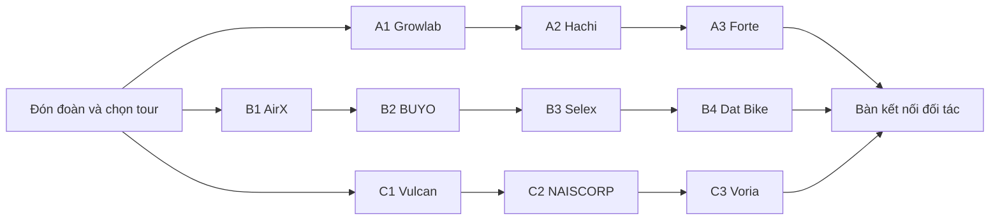

# Đề xuất 3 tour trải nghiệm 10 startup

**Bối cảnh:** cùng một địa điểm triển lãm; khách là đối tác/doanh nghiệp; mỗi tour60–90 phút. Mỗi tour đi3–4 gian, tổng ba tour bao phủ10 startup không lặp. Đây là phương án tuyển chọn và thiết kế trải nghiệm, **chưa xác nhận startup tham gia hoặc khả năng cung cấp bộ demo**.

Bảng vận hành chi tiết: tab [Tour_Trien_lam trong Google Sheet](https://docs.google.com/spreadsheets/d/1eEoxBVgZ_Azcp-T2qH5hsIF4GmjYZMtS4h-3l_mfLdA/edit?gid=1009#gid=1009). Bảng có10 điểm dừng, vật mẫu, thao tác, thời gian, điều kiện chốt và nguồn sản phẩm. Đã đọc lại338 ô và10 liên kết nguồn; việc kiểm tra này xác nhận nội dung bảng, không xác nhận bộ demo đã sẵn sàng.

## Cách chọn điểm dừng

Lấy từ danh sách Đạt tại ngày28/10/2026:9 doanh nghiệp có đầu ra vật lý và1 doanh nghiệp có Hub tích hợp phần mềm. Mỗi gian cần có vật thật, thao tác cụ thể và người hướng dẫn. Việc đạt sàng lọc doanh nghiệp không đồng nghĩa đã sẵn sàng trình diễn tại triển lãm. Chỉ chốt lịch khi startup xác nhận mẫu sản phẩm, thao tác cho khách và người vận hành.

| Tour | Chủ đề | Thứ tự gian | Thời lượng đề xuất |
|---|---|---|---:|
|A|Từ cây giống đến nông trại thông minh|Growlab → Hachi → Forte Biotech|75 phút|
|B|Vật liệu tuần hoàn và di chuyển điện|AirX Carbon → BUYO → Selex Motors → Dat Bike|90 phút|
|C|Công nghệ chăm sóc và hỗ trợ con người|Vulcan Augmetics → NAISCORP Robotics → Voria Solution|75 phút|

## Tour A — Từ cây giống đến nông trại thông minh

Mạch dẫn: **giống cây → điều khiển môi trường trồng → xét nghiệm tại cơ sở nuôi**. Ba điểm phản ánh những công đoạn khác nhau của nông nghiệp; không trình bày như một dây chuyền liên doanh đã có.

| Điểm | Startup / vật thật cần mang | Trải nghiệm đề xuất cho khách | Phút tại gian |
|---|---|---|---:|
|A1|**Growlab:** cây giống dừa nuôi cấy mô Multipuno, bình mẫu kín và cây đã ra vườn ươm|Cầm bình mẫu kín, quan sát các giai đoạn; thao tác đặt cây giống vào khay trồng trên bộ thực hành được hãng chuẩn bị.|18|
|A2|**Hachi:** giàn trồng nhỏ có cây, cảm biến và bộ điều khiển đang hoạt động|Đặt đầu dò vào khay nước demo, đọc số liệu và thử một lệnh tưới/bơm có phản hồi vật lý. Quy mô giàn demo phải được Hachi xác nhận.|18|
|A3|**Forte Biotech:** máy RAPID, bộ ống/khay và mẫu đối chứng phù hợp trình diễn|Thử thao tác chuẩn bị ống bằng nước/mẫu thực hành, xem kỹ thuật viên nạp mẫu, đối chiếu kết quả đã chạy trước. Không hứa hoàn tất xét nghiệm trong18 phút.|18|

**Lịch tương đối:**00–05 đón đoàn;05–23 Growlab;23–26 di chuyển;26–44 Hachi;44–47 di chuyển;47–65 Forte;65–75 trao đổi hợp tác.

**Đầu ra cho đối tác:** xác định một nhu cầu về giống cây, một nhu cầu tự động hóa trang trại hoặc một bài toán xét nghiệm để hẹn trao đổi kỹ thuật. Không dùng buổi demo để kết luận năng suất cây hoặc độ chính xác chẩn đoán.

Nguồn sản phẩm: [Growlab](https://growlab.com.vn/), [cửa hàng Hachi](https://hachi.com.vn/shop/), [RAPID](https://fortebio.tech/). Danh mục và mô tả là căn cứ chọn vật trưng bày; thao tác trên là thiết kế đề xuất, chưa được nhà cung cấp xác nhận.

## Tour B — Vật liệu tuần hoàn và di chuyển điện

Mạch dẫn: **chạm vào vật liệu → dùng sản phẩm hoàn thiện → trải nghiệm hai cách sử dụng xe điện**. AirX tập trung mẫu ly và vật liệu; BUYO tập trung ứng dụng bao bì. Selex tập trung pin/đổi pin; Dat Bike tập trung công thái học, điều khiển và thao tác sạc để hai gian xe không lặp nội dung.

| Điểm | Startup / vật thật cần mang | Trải nghiệm đề xuất cho khách | Phút tại gian |
|---|---|---|---:|
|B1|**AirX Carbon:** ly bã cà phê và mẫu vật liệu có nhãn thành phần|Cầm, so sánh bề mặt/khối lượng, đóng mở nắp và bố trí một bộ quà tặng mẫu. Có thể bổ sung mẫu pallet nếu phù hợp vận chuyển.|16|
|B2|**BUYO:** hộp, khay, túi hoặc bộ đồ dùng từ danh mục sản phẩm|Đóng mở hộp, gấp/đóng gói vật mẫu khô; đối chiếu loại vật liệu với yêu cầu sử dụng của doanh nghiệp.|16|
|B3|**Selex Motors:** xe điện và cụm pin/đổi pin dùng trình diễn|Ngồi thử xe, xem cấu tạo pin tháo rời và thử thao tác đổi pin theo hướng dẫn của hãng; chốt trước có mang được cụm đổi pin hoạt động hay không.|16|
|B4|**Dat Bike:** xe điện, phụ kiện sạc và bộ điều khiển dùng demo|Ngồi thử, thao tác màn hình/điều khiển và kết nối bộ sạc demo theo hướng dẫn. Lái thử là hoạt động bổ sung, chỉ bố trí nếu có làn riêng và phương án vận hành của hãng.|16|

**Lịch tương đối:**00–05 đón đoàn;05–21 AirX;21–24 di chuyển;24–40 BUYO;40–43 di chuyển;43–59 Selex;59–62 di chuyển;62–78 Dat Bike;78–90 trao đổi hợp tác.

**Đầu ra cho đối tác:** chọn một mẫu vật liệu/bao bì cần đánh giá hoặc một kịch bản xe điện cần thử nghiệm. Các câu hỏi chốt gồm thông số, lượng đặt mẫu, điều kiện sử dụng, bảo hành và hỗ trợ triển khai. Việc cầm mẫu không chứng minh khả năng phân hủy, chứng nhận tiếp xúc thực phẩm hoặc hiệu quả giảm phát thải.

Nguồn sản phẩm: [ly AirX](https://airxcoffee.com/pages/qua-tang-doanh-nghiep), [danh mục BUYO](https://buyosolutions.com/Product), [Selex](https://selex.vn/selex-camel/), [Dat Bike](https://dat.bike/).

## Tour C — Công nghệ chăm sóc và hỗ trợ con người

Mạch dẫn: **hỗ trợ thao tác của con người → tương tác với robot → kết nối dữ liệu từ thiết bị**. Nội dung hướng tới bài toán triển khai tại cơ sở chăm sóc, tổ chức dịch vụ hoặc đơn vị tích hợp.

| Điểm | Startup / vật thật cần mang | Trải nghiệm đề xuất cho khách | Phút tại gian |
|---|---|---|---:|
|C1|**Vulcan Augmetics:** bàn tay điện trên giá thử, bộ điều khiển và vật mẫu|Thử điều khiển tay gắp/thả một vật nhẹ trên bộ thực hành do hãng chuẩn bị. Không tổ chức lắp tay giả đại trà lên khách.|18|
|C2|**NAISCORP Robotics:** Healthmate hoặc mẫu robot dịch vụ được chốt|Khách chọn tác vụ, ra yêu cầu và quan sát robot thật phản hồi theo kịch bản đã tổng duyệt. Cần xác nhận đúng mẫu robot và thao tác khách được thực hiện.|18|
|C3|**Voria Solution:** Voria Hub, thiết bị ngoại vi tương thích và điện thoại demo|Cầm Hub, thực hiện bước ghép nối/kết nối, kích hoạt dữ liệu thử và xem đồng bộ trên tài khoản demo. Dùng dữ liệu mẫu, không thu bệnh sử hoặc dữ liệu sức khỏe thật của khách.|18|

**Lịch tương đối:**00–05 đón đoàn;05–23 Vulcan;23–26 di chuyển;26–44 NAISCORP;44–47 di chuyển;47–65 Voria;65–75 trao đổi hợp tác.

**Đầu ra cho đối tác:** xác định yêu cầu tích hợp thiết bị, đào tạo người vận hành và phạm vi thử nghiệm. Các trải nghiệm này không phải khám, chẩn đoán hoặc chứng minh hiệu quả điều trị.

Nguồn sản phẩm: [Vulcan](https://www.wearevulcan.com/), [NAISCORP](https://www.naiscorp.com/en), [mô tả Hub và thiết bị tương thích của Voria](https://play.google.com/store/apps/details?hl=en_US&id=com.voriasolution.voria_care). Riêng Voria chỉ giữ điểm dừng khi có **Hub thật hoạt động**; việc chỉ trình chiếu ứng dụng không đáp ứng thiết kế tour này.

## Bố trí và nhịp vận hành

- **Quy mô đề xuất:**10–12 khách/đoàn; chia cặp khi thao tác. Một hướng dẫn viên dẫn tour; mỗi startup cử một người trình diễn và một người phụ trách trao đổi đối tác.
- Tại gian18 phút:3 phút đặt bài toán,2 phút trình diễn,8 phút trải nghiệm,3 phút ứng dụng,2 phút hẹn bước tiếp theo. Gian16 phút:2+2+7+3+2 phút.
- Với thiết bị chỉ vận hành được một lượt mỗi chu kỳ, chuẩn bị bàn thực hành song song và chọn đại diện vận hành máy. Không hứa mọi khách chạy trọn một chu kỳ máy.
- Ba tour có thể chạy song song cho ba đoàn khác nhau nếu đủ nhân sự. Một đoàn muốn đi cả ba cần240 phút, chưa tính nghỉ; không ghép cả10 gian vào một tour75 phút.
- Khu A cần xử lý nước và mẫu thực hành gọn; khu C ưu tiên yên tĩnh; hai gian xe đặt gần khu thử xe riêng nếu có. Đây là sơ đồ chức năng, chưa phải mặt bằng theo kích thước thực tế.

## Điều kiện để chuyển từ đề xuất sang lịch chốt

1. Chốt tên/mã mẫu mang tới, số lượng vật mẫu và thao tác khách được làm ở từng gian.
2. Xác nhận điện, nước, mạng, kích thước, tải trọng và thời gian lắp đặt với từng startup; hiện chưa có số liệu để lập dự toán mặt bằng.
3. Trước sự kiện7 ngày, nhận xác nhận bộ demo và người vận hành; trước khai mạc, chạy thử toàn tuyến theo đúng nhịp16/18 phút và thời gian đặt lại thiết bị.
4. Với RAPID, chuẩn bị kết quả chạy trước và mẫu thực hành phù hợp; với tay/robot, dùng giá thử/khu vận hành do hãng xác nhận; với Voria, dùng thiết bị và dữ liệu demo đã kiểm tra.
5. Chỉ công bố gian có trải nghiệm khi bộ demo đã qua tổng duyệt. Chưa có xác nhận tham gia, lịch sự kiện, mặt bằng hoặc ngân sách trong phương án này.

**Cách sử dụng:** chọn một tour theo nhóm đối tác, kết thúc bằng một phiếu nhu cầu thử nghiệm/hợp tác. Các bước liên hệ, mời doanh nghiệp và đăng ký tham gia chưa được thực hiện.
